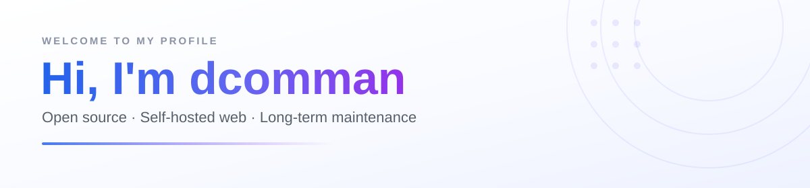

<picture>
  <source media="(prefers-color-scheme: dark)" srcset="https://raw.githubusercontent.com/dcomman/dcomman/main/assets/banner-dark.svg">
  
</picture>

<!--
  ═══════════════════════════════════════════════════════════════════════════
  Profile README · 自定义说明（HTML 注释不会渲染，可随时删除）

  【刻意留空、不臆造的内容】
    姓名 / 所在地 / 公司 / 邮箱 / 博客 / 社交链接 —— 当前一律未填写，
    因为账号公开资料里没有这些信息。要公开的话由你本人补，见文末「联系」。

  【建议你按意愿修改的地方】
    1. 关于我       —— 现在是一段中性的、不涉及身份的描述，可改成你自己的话。
    2. 当前在做     —— 取自当前公开项目的实际工作内容；不想展示技术细节可整段删。
    3. 技术栈图标   —— 增删 skillicons 的 i= 参数即可；第三方服务，可整段删。
    4. 数据卡片     —— github-readme-stats 第三方服务，可整段删；删后页面不依赖外部图片。
    5. 联系         —— 只放了 GitHub 链接；邮箱 / 博客 / 社交链接按需补。

  【两处技术注意点】
    · Banner 用 raw.githubusercontent.com 绝对地址，因为 GitHub 不重写 <source srcset>
      里的相对路径。若以后改了默认分支名，把上面两条 URL 里的 main 一起改掉。
    · 浅色 / 深色靠 <picture> 的 prefers-color-scheme 自动切换，无需手动开关。

  【配套设置（不在此文件内，需到 GitHub 设置页手动做）】
    Profile bio、头像、Pinned repositories、Social accounts。
  ═══════════════════════════════════════════════════════════════════════════
-->

## 👋 关于我

维护开源项目，关注自托管 Web 应用与长期可维护的代码。习惯先把现状弄清楚，再小步改动，让每一步都能验证、能回滚。

<!-- [可改] 若愿意公开，可在这里补充姓名 / 所在地 / 职业方向；当前未填写任何未经确认的个人信息。 -->

## 🚧 当前在做

- **安全维护** —— 跟进上游已停更项目中未修复的安全问题，补回归测试，独立发止血版本。
- **版本升级** —— PHP 与 Laravel 的跨大版本逐级升级，先摸清依赖阻塞，再动代码。
- **可复现环境** —— 用容器固化构建与验证流程，让升级能在干净环境里完整重跑。

<!-- [可改] 以上来自当前公开项目的实际工作；若不想在个人首页展示具体技术细节，可整段删除或改写。 -->

## 🛠 技术栈

  <picture>
    <source media="(prefers-color-scheme: dark)" srcset="https://skillicons.dev/icons?i=php,laravel,composer,docker,ts,js,mysql,sqlite,nginx,git,linux,bash,github&amp;theme=dark&amp;perline=7">
    
  </picture>

<!-- [可改] 第三方图片服务。想完全自持或担心失效，删掉上面整个 
 段落即可。 -->

## 📊 GitHub 数据

  <picture>
    <source media="(prefers-color-scheme: dark)" srcset="https://github-readme-stats.vercel.app/api?username=dcomman&amp;show_icons=true&amp;hide_border=true&amp;theme=dark&amp;title_color=60a5fa&amp;icon_color=a78bfa&amp;bg_color=0d1117&amp;text_color=c9d1d9">
    
  </picture>

<!-- [可改] 同样是第三方服务（github-readme-stats）。它读取公开数据，不需要授权；删掉本段不影响其它内容。 -->

## 📫 联系

GitHub · [@dcomman](https://github.com/dcomman)

<!-- [可改] 如需公开邮箱 / 博客 / 其它社交链接，在这里补；当前不预填。 -->

---

此页面由 <code>dcomman/dcomman</code> 仓库的 README.md 渲染 · 浅色 / 深色自适应

